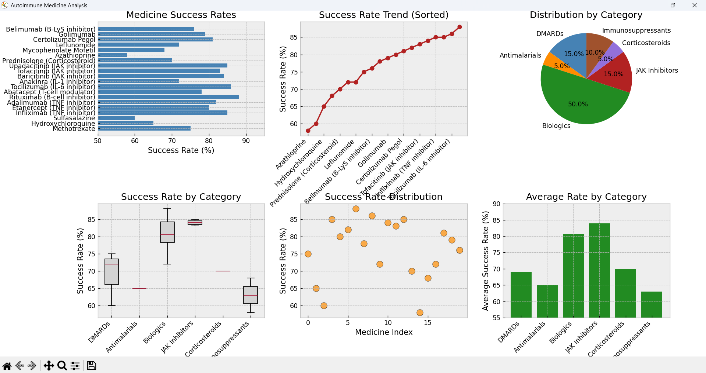

# Autoimmune Medicine Response Analysis 🧬📊

A Python visualization exploring treatment response rates across drug classifications (Biologics, JAK Inhibitors, Traditional DMARDs, Corticosteroids).

> **Note on Portfolio Organization:** This exploratory investigation is archived and superseded by the comprehensive [Global Autoimmune Disease Analysis Dashboard](https://github.com/sushanttds-jpg/Global-Autoimmune-Disease-Analysis-Dashboard).

## 📊 Visualization



## Features
- **Categorical Comparison:** Average response rates across Biologics, JAK Inhibitors, and DMARDs.
- **Distribution Analysis:** Box plots and variance across therapeutic classes.
- **Classification Share:** Distribution of medications across mechanism-of-action types.

## Setup & Execution
```bash
pip install matplotlib numpy
python autoimmune_drugs.py
```
